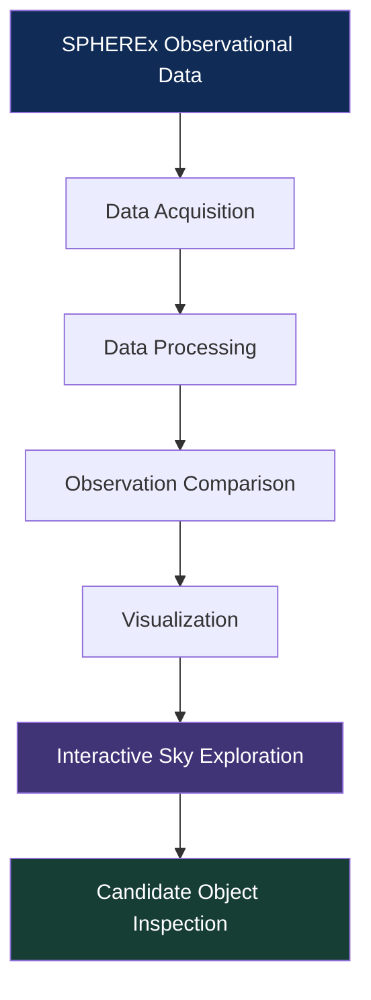

# SPHEREx-Sky-Viewer — Exploring the Dynamic Universe

<p align="center">
  
  
  
  
</p>

<h3 align="center">Discovering the Universe, One Observation at a Time.</h3>

<p align="center">
  <i>An interactive near-infrared time-series flipbook for exploring NASA's SPHEREx sky survey.</i>
</p>

---

## About the Project

**SPHEREx Sky Viewer** turns multi-epoch near-infrared data from NASA's SPHEREx space telescope into fast-loading, looped web flipbooks. Instead of digging through raw FITS files, users can enter sky coordinates and watch how a patch of sky changes over time—making it easier for researchers, students, and citizen scientists to spot moving or variable objects like asteroids, brown dwarfs, and variable stars.

## Why SPHEREx Needs a Visual Flipbook

NASA's SPHEREx telescope launched on **March 11, 2025**, aboard a SpaceX Falcon 9 from Vandenberg Space Force Base. It maps the entire sky every six months across **102 near-infrared spectral bands**, capturing more than **one billion objects**.

That scale creates a clear bottleneck:
- **Too much data for manual review:** Over a billion sources across 102 bands cannot be inspected by hand.
- **Automated scripts miss subtle signals:** Faint sources, slow proper motion, and overlapping or variable objects often slip past automated pipelines.
- **Human pattern recognition helps, but raw data is hard to use:** Projects like Backyard Worlds show how effective human eyes are at catching moving targets, yet multi-band FITS data is still intimidating without purpose-built tools.

### Core Goal
Build a public web tool that takes a **Right Ascension (RA)** and **Declination (Dec)** and loops multi-epoch images for that patch of sky.

---

## Features

- **Coordinate-Driven Sky Lookup:** Enter RA and Dec to load time-series cutouts for a specific region.
- **Time-Series Frame Controls:** Loop observations across epochs, step frame-by-frame, or add and subtract frames to highlight motion and brightness changes.
- **102-Band Spectral & Multi-Band Tools:** Combine SPHEREx bands to improve signal-to-noise and inspect spectral features on the fly.
- **Adjustable Field of View:** Balance wide coverage (helpful for faster-moving targets) against download speed.
- **External Catalog Overlays:** Cross-check regions against external archives such as Gaia and WISE.
- **Shareable URLs:** Encode RA/Dec coordinates directly in the URL for quick sharing or embedding.
- **Quality & Contamination Flags:** Surface pixel-status and contamination flags so instrumental artifacts aren't mistaken for real objects.
- **Open-Source Stack:** Built around open tools including Astropy and Aladin/Web.

---

## Tech Stack

| Layer | Tools |
| :--- | :--- |
| **Frontend** | HTML5, CSS3, JavaScript |
| **Backend** | Python |
| **Data Processing** | Astropy, PyVO |
| **Visualization** | Custom Canvas / Image Flipbook Engine |
| **Data & APIs** | NASA/IPAC Infrared Science Archive (IRSA) SIA2, AWS S3 |

---

## How It Works



1. **Data Acquisition:** Query near-infrared cutouts by RA/Dec using NASA/IPAC IRSA SIA2 endpoints and AWS S3 open data buckets.
2. **Data Processing:** Parse multi-extension FITS arrays with Astropy and PyVO and order frames across survey sweeps.
3. **Observation Comparison:** Compare 6-month survey epochs side-by-side or in a loop to catch proper motion and variability.
4. **Visualization:** Render frames in a browser flipbook with adjustable frame rates and band controls.
5. **Candidate Inspection:** Review targets and benchmark objects such as **WISE 0855** and **Barnard's Star**.

---

## Project Preview

<!-- Replace placeholder paths with screenshots from your app -->

| Dashboard | Sky Visualization |
| :---: | :---: |
| `` | `` |
| **Time Comparison** | **Object Exploration** |
| `` | `` |

---

## Scientific Data & Methodology

### Data Sources
- [NASA SPHEREx Mission](https://spherex.caltech.edu/)
- [NASA Science](https://science.nasa.gov/)
- [NASA Open Data Portal](https://data.nasa.gov/)
- [NASA/IPAC Infrared Science Archive (IRSA)](https://irsa.ipac.caltech.edu/)

### How We Analyze Observations
- **Multi-Epoch Near-Infrared FITS Handling:** Uses Astropy and PyVO to parse multi-extension FITS files and isolate wavelength bands sensitive to molecular signatures ($\text{H}_2\text{O}$, $\text{CO}_2$, $\text{CO}$).
- **Proper Motion, Parallax & Variability:** Steps through 6-month survey sweeps to surface:
  - High proper-motion stars (e.g., **Barnard's Star**)
  - Cold, faint sub-stellar brown dwarfs missed by standard color cuts (e.g., **WISE 0855**)
  - Variable stars changing in brightness over time (e.g., **RW Aurigae**, **R Draconis**)
- **Quality Flags & Exploratory Scope:** Pulls pixel-status and contamination flags from IRSA to filter out instrumental artifacts. Any moving or variable target flagged in the viewer is an **exploratory candidate** and requires follow-up spectroscopic or photometric confirmation.

---

## Impact

Space data shouldn't only live inside specialized labs. This project is built to make survey archives approachable for students, educators, and curious skywatchers—giving them hands-on tools to explore real NASA observations.

---

## Team

- **Kamalesh Krithik** — *Integration, Presentation & Domain Lead*  
  Project architecture, README documentation, scientific validation, and pitch presentation.
- **Ramsha Rais** — *Backend Data Engineer*  
  Python pipeline, Astropy/PyVO integration, and IRSA SIA2 API data querying.
- **Harsh Sahu** — *Frontend Web Developer*  
  UI/UX layout, coordinate search interface, and flipbook controls.
- **Piyush Warang** — *Data & Systems Specialist*  
  FITS image parsing, cache optimization, and target preset validation.

---

## Getting Started

### Prerequisites
- Git
- Python 3.9+
- A modern web browser (Chrome, Firefox, Edge, Safari)

### Installation

```bash
git clone [https://github.com/rr-codes4/SPHEREX-Sky-Viewer.git](https://github.com/rr-codes4/SPHEREX-Sky-Viewer.git)
cd SPHEREX-Sky-Viewer
pip install -r requirements.txt
py app.py
```

---

## Acknowledgements

- **NASA** — For the SPHEREx mission and open astronomical data.
- **NASA Space Apps Challenge** — For the platform and momentum to build it.
- **The Open-Source Community** — For the libraries and tools that make astronomical web apps possible.

<p align="center">
  
</p>

<h2 align="center">LOOK UP. EXPLORE. DISCOVER.</h2>

<p align="center">
  <i>Exploring the universe, one observation at a time.</i><br><br>
  <b>NASA Space Apps Challenge 2026</b>
</p>
